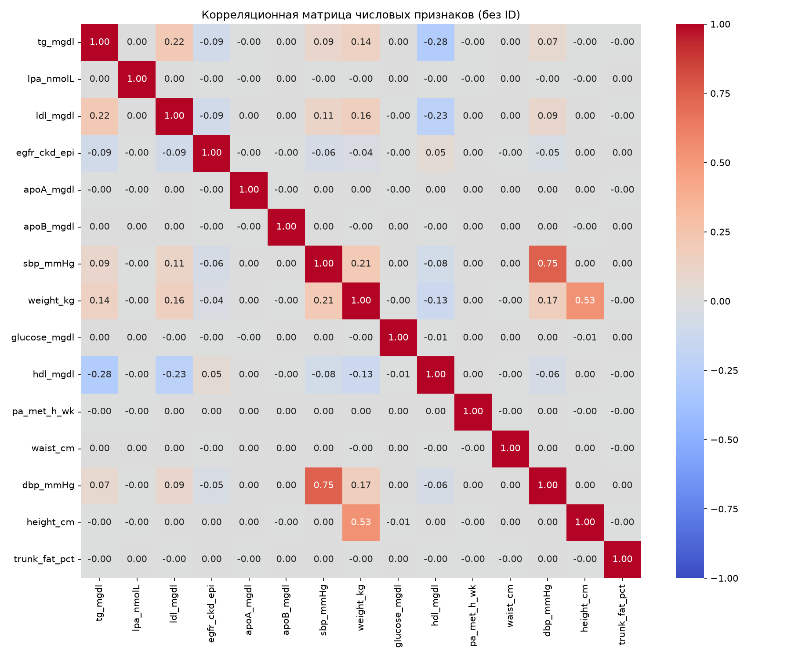
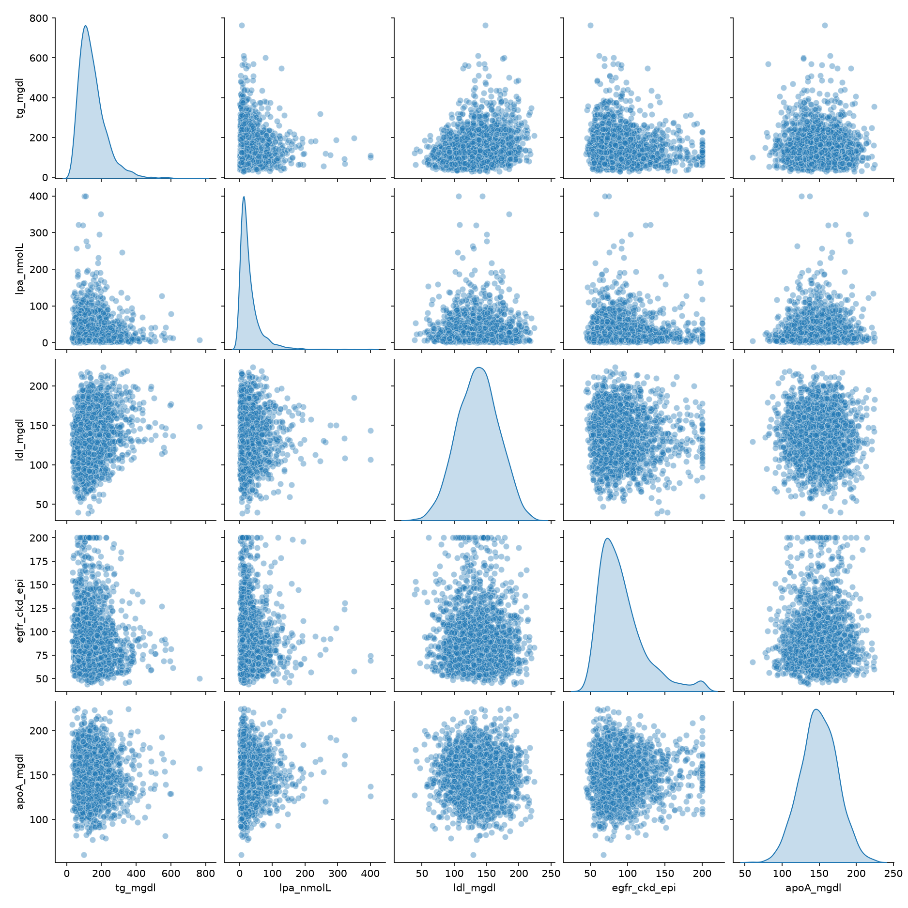

# Разведочный анализ и предобработка данных (EDA) — Курсовая работа

## 1–2. Изучение данных, размерность и сложности работы
* **Объём данных:** 500 000 строк, 56 столбцов (32 вещественных `float64`, 20 целочисленных `int64`, 4 строковых `str`).
* **Вес данных:** 117.37 МБ на диске и 320.18 МБ в оперативной памяти (RAM).
* **Сложности работы с данными:**
  1. Большой размер файла (> 100 МБ) превышает стандартный лимит GitHub и требует использования систем версионирования данных (DVC).
  2. Высокая размерность (56 признаков) затрудняет визуальный анализ и требует отбора топ-15 признаков для построения читаемых матриц корреляций.
  3. Сильная правосторонняя асимметрия биохимических показателей (например, максимальное значение `tg_mgdl` достигает 1000 при медиане 131.5, `lpa_nmolL` — 400 при медиане 18.7), что требует аккуратного сглаживания выбросов без потери записей.

## 3. Признаки, шкалы измерений и Feature Engineering
* **Шкалы измерений:**
  * *Абсолютная (шкала отношений):* рост (`height_cm`), вес (`weight_kg`), артериальное давление (`sbp_mmHg`, `dbp_mmHg`), концентрация веществ в крови (`glucose_mgdl`, `ldl_mgdl`, `tg_mgdl`, `apoA_mgdl` и др.). Имеют естественный ноль и допускают любые арифметические операции.
  * *Номинальная шкала:* строковые категориальные столбцы (`ancestry`, `smoking_status`), бинарные флаги заболеваний/терапии и технический идентификатор `id`.
  * *Порядковая шкала:* уровень образования (`education_level`) и уровень дохода (`income_bracket`).
* **Преобразования и Feature Engineering:**
  * Столбец `id` удалён, так как он является техническим индексом и не несет обобщающей способности.
  * Категориальные признаки переведены в числовой вид с помощью кодирования.
  * *Зачем нужен Feature Engineering:* алгоритмы машинного обучения работают только с числовыми матрицами. Преобразование текстовых категорий и сглаживание экстремальных выбросов напрямую повышает стабильность и точность будущих прогнозных моделей.

## 4. Выбор способа хранения данных (Файл vs БД)
Для этапа исследования и обучения моделей **реляционная БД (PostgreSQL/MySQL) избыточна**. Объём выборки (320 МБ в RAM) легко обрабатывается в оперативной памяти средствами `pandas`, а работа ведется со статичным срезом данных. Оптимальным решением является файловое хранение в формате **CSV** (или **Parquet**). Реляционная БД потребуется только при развертывании модели в продакшн с потоковым обновлением записей пациентов.

## 5. Анализ корреляций и визуализация
Для читаемости графиков отобраны топ-15 признаков с наибольшей дисперсией (после исключения `id`).

* **Сильные и умеренные зависимости:**
  * Систолическое и диастолическое артериальное давление (`sbp_mmHg` и `dbp_mmHg`) имеют сильную положительную корреляцию (**0.75**).
  * Рост (`height_cm`) и вес (`weight_kg`) показывают умеренную положительную связь (**0.53**).
* **Слабые зависимости:**
  * Показатели липидного профиля (`tg_mgdl`, `ldl_mgdl`, `hdl_mgdl`) слабо коррелируют между собой (коэффициенты от **-0.28** до **0.22**).
* **Распределения (KDE):**
  * Показатели `ldl_mgdl` и `apoA_mgdl` имеют форму, близкую к нормальному распределению.
  * Показатели `tg_mgdl`, `lpa_nmolL` и `egfr_ckd_epi` имеют выраженную правостороннюю асимметрию.

## 6. Статистические показатели
* **Числовые признаки:** Для асимметричных анализов среднее (`mean`) заметно превышает медиану (`50%`), например, у `lpa_nmolL` среднее 30.77 при медиане 18.70. Бинарные признаки (например, `ckd`, `on_dm_meds`) имеют сильный дисбаланс классов (доля положительного класса менее 1–3%).
* **Категориальные признаки:** В выборке преобладают люди европейского происхождения (`European` — 491 105 из 500 000) и никогда не курившие (`never` — 275 450).

## 7. Обработка пропусков и выбросов
* **Пропуски и дубликаты:** Явных и скрытых пропусков (`?`, `None`, `null`), а также полных дубликатов строк не обнаружено (0 шт.).
* **Выбросы:** Применена **винзоризация (clipping)** по 1-му и 99-му перцентилям для 29 непрерывных признаков. Целевые переменные времени до наступления событий (`time_ascvd_yrs`, `time_hf_yrs`, `time_af_yrs`) и бинарные флаги не изменялись, чтобы не искажать целевую метку для будущих моделей.

## 8. Кодирование категориальных признаков
Все 4 категориальных признака (`ancestry`, `smoking_status`, `education_level`, `income_bracket`) имеют низкую кардинальность (от 2 до 5 уникальных значений). Для них применён метод **One-Hot Encoding** (`drop_first=True`), так как он не вносит ложного порядка между категориями и увеличивает ширину таблицы незначительно (с 56 до 62 столбцов).

## 10. GitHub и целесообразность использования DVC
* **DVC (Data Version Control)** — инструмент версионирования больших наборов данных поверх Git.
* **Нужен ли DVC в проекте:** **Да, необходим.** Исходный файл `Circulation_2021_500k.csv` весит 117.37 МБ, а итоговый `circulation_preprocessed.csv` ещё больше, что превышает лимит GitHub в 100 МБ на один файл. DVC позволяет хранить в репозитории только легкие `.dvc`-файлы с контрольными суммами, а сами датасеты выгружать в облачное хранилище.
